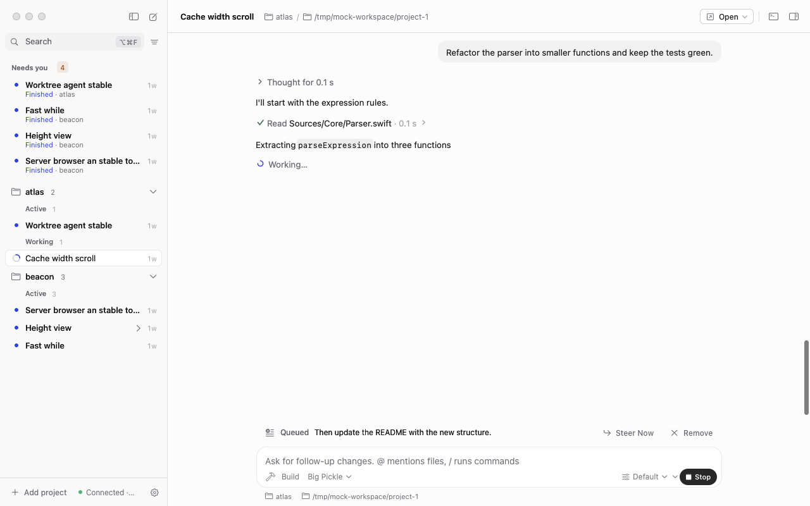

# BelloCode

BelloCode is a native macOS app for working with coding agents. It wraps a bundled, pinned
[opencode](https://github.com/anomalyco/opencode) server (2.3.2) in an AppKit and SwiftUI interface: threads per
project, a streaming transcript, approvals and questions pinned above the composer, a diff panel, terminals, a
built-in browser and agents that delegate work to other agents. Every command the agent or you run executes in a
container through Rancher Desktop, not on the Mac (the optional **Host shell, docker only** mode is the one exception:
it runs a sandboxed `docker` client on the Mac and offers no terminals).

It was built for one organisation's setup and makes that organisation's choices: GitLab (self-managed, reached through
its API with a personal access token) rather than GitHub, Rancher Desktop for containers, a company proxy and CA on
the network, and Apple Silicon Macs. Some defaults name that organisation's GitLab instance. It is published so the
code can be read and built, not as a general-purpose product.

<picture>
  <source media="(prefers-color-scheme: dark)" srcset="docs/snapshots/app-running-queued-dark-1280x800.png">
  
</picture>

Screenshots are rendered by the app's own snapshot harness from fixture data; more are in
[docs/snapshots/](docs/snapshots/).

## Features

| Area | What you get | Notes |
| --- | --- | --- |
| Threads and transcript | Sidebar grouped by project or state, instant switching, virtualised transcript with tool cards, find, Markdown and code highlighting | [navigation](docs/features/navigation.md), [transcript](docs/features/transcript.md) |
| Composer | Drafts that survive relaunch, attachments, `@` mentions, `/` commands, Send, Queue, Steer and Stop as distinct actions | [composer](docs/features/composer.md) |
| Approvals and models | Approvals and questions pinned above the composer; per-thread model picker; models for background tasks | [agent UI](docs/features/agent-ui.md), [models](docs/features/models.md) |
| Auto mode | A risk policy approves routine work and escalates risky actions to you, with an audit log per thread | [auto mode](docs/features/auto-mode.md) |
| Containers | Shared workspace container over your code roots, per-project containers or dev containers, a filtered Docker endpoint, services, caches, MCP servers | [containers](docs/features/containers.md), [execution modes](docs/features/execution-modes.md) |
| Secrets | Keychain secrets the agent uses without seeing (brokered or placeholder through an egress proxy), or visible on purpose | [secrets](docs/features/secrets.md) |
| Diff and git | Changes panel, review comments, revert, commit, push, pull, worktrees, stash, checkpoints and rewind | [diff and git](docs/features/diff-git.md), [git parity](docs/features/git-parity.md) |
| GitLab | Merge request panel, pipelines and job logs, inline review, issues, to-dos, babysitting, agent tools | [GitLab](docs/features/gitlab.md) |
| Orchestration | Agents delegate to child agents, fan out into threads, message and stop each other; Agents panel; scheduled tasks | [orchestration](docs/features/orchestration.md), [extras](docs/features/orchestration-extras.md) |
| Browsers | A built-in WebKit browser for previews, and one shared Chromium (in a container) that agents drive with `browse` | [browser](docs/features/browser.md), [shared Chrome](docs/features/shared-browser.md) |
| Terminal | Terminal drawer and panel on opencode's persistent PTYs, running in the container | [terminal](docs/features/terminal.md), [shell](docs/features/shell.md) |
| opencode | Isolated opencode data and config, a `bellocode-opencode` CLI, per-project trust for repository config, a repeatable upgrade gate | [opencode config](docs/features/opencode-config.md), [upgrades](docs/features/opencode-upgrades.md), [engine](docs/features/engine.md) |

The [user guide](docs/USER-GUIDE.md) explains how to use all of this.

## Requirements

- An Apple Silicon (arm64) Mac with macOS 15 or later. Intel Macs are not supported: `Scripts/make-app.sh` refuses
  to build there, and the shared Chrome image is arm64 only.
- To build: Swift 6.4 from the Command Line Tools for Xcode (`xcode-select --install`). Xcode itself is not needed and
  there is no Xcode project. Approved pushes need the Command Line Tools' git to be 2.46 or Apple Git-155 or later.
- To run commands, terminals and the shared Chrome: [Rancher Desktop](https://rancherdesktop.io) with the **dockerd
  (moby)** container engine. Without it the app still chats, but every command is refused rather than run on the Mac.
- Network access for the first build: SwiftPM fetches the Swift packages and `Scripts/fetch-opencode.sh` downloads the
  pinned opencode from opencode.ai and ripgrep from GitHub, both checked against the SHA-256 sums in `Scripts/`.
  Container features pull base images from public registries (Docker Hub).
- A model provider: opencode's free models work without an account (with a usage limit); paid providers are
  connected in the app or with the CLI.
- For GitLab features: a GitLab personal access token (`read_api`, or `api` if you allow write actions).

## Build from source

Use the `make` targets. They export the four `SWIFTTERM_BUILD_*` values without which SwiftTerm's build plugin can
stall indefinitely under Command Line Tools ([deep review D1](docs/reviews/deep-review-1.md)).

```sh
make fetch      # download and verify the pinned opencode (Scripts/opencode-version) and ripgrep into Vendor/
make build      # swift build, all modules
make app        # fetch, then assemble and ad-hoc sign build/BelloCode.app (CONFIG=release for a release build)
make run        # make app, then open build/BelloCode.app
make smoke      # make app, then a headless check of the bundled server (--smoke-test)
make release    # the release zip build/BelloCode-<VERSION>.zip, checked from an unzipped, quarantined copy
make clean      # remove .build and build
```

`make` runs `swift build` and `swift test` underneath. If you call `swift` directly, first export the four
`SWIFTTERM_BUILD_*` values exactly as the [Makefile](Makefile) sets them. The linker's `search path ... not found`
warnings for Command Line Tools paths are harmless.

## Install a release build

Releases are a zip of `BelloCode.app`. The app is **ad-hoc signed and not notarised**, so Gatekeeper refuses to open
a downloaded copy until you allow it once. Check the zip's SHA-256 against the one published with it, then:

```sh
ditto -x -k BelloCode-<version>.zip /Applications
xattr -dr com.apple.quarantine /Applications/BelloCode.app
open /Applications/BelloCode.app
```

Or open it from Finder, let macOS refuse, and click **Open Anyway** in System Settings ▸ Privacy & Security. Each new
copy needs this once. [docs/RELEASE.md](docs/RELEASE.md) describes how the zip is built and checked.

## First run

1. **Install and start Rancher Desktop** and choose the dockerd (moby) engine in its preferences.
2. **Open BelloCode.** The welcome screen offers to import credentials from an existing opencode install and to
   connect a provider; free models work without either. BelloCode keeps its own opencode data and never writes
   to `~/.config/opencode` or `~/.local/share/opencode`; it reads accounts from an existing install only when you choose
   **Import from opencode**.
3. **Set your code roots and image** in Settings ▸ Containers: the folder(s) your repositories live in (shared with
   Rancher Desktop) and a default workspace image. There is no built-in default image.
4. **Add a project** (File ▸ Add Project…, ⇧⌘O) and start a thread (⌘N).
5. **Optional:** add your GitLab instance and token in Settings ▸ GitLab, choose models for background tasks in
   Settings ▸ Models, and install the command-line tool (BelloCode ▸ Install Command Line Tool…).

The [user guide](docs/USER-GUIDE.md) covers each step and what to do when something is refused.

## Testing

```sh
make test         # swift test: every Swift Testing suite (mocks, fixtures, in-process servers)
make plugin-test  # the opencode plugin's bun tests, run in a container (bun never runs on the Mac)
make smoke        # the bundled app's headless self-check
```

`make test` runs without Rancher Desktop, credentials or network. Suites that need real dependencies are opt-in by
environment variable and run with `swift test --filter <Suite>` (export the `SWIFTTERM_BUILD_*` values first):

| Variable | Enables |
| --- | --- |
| `BELLOCODE_CONTAINER_TESTS=1` | Live container suites against Rancher Desktop (workspaces, Docker filter, services, MCP). Some need `node:22-bookworm-slim` pulled |
| `BELLOCODE_BROWSER_REAL=1` | With the above: the shared Chrome against the real opencode |
| `BELLOCODE_CONTRACT_REAL=1` | Contract checks against the vendored opencode binary (part of `make opencode-verify`) |
| `BELLOCODE_AUTO_REAL=1`, `BELLOCODE_POLICY_REAL=1`, `BELLOCODE_ORCH_REAL=1`, `BELLOCODE_GIT_REAL=1`, `BELLOCODE_GITLAB_REAL=1`, `BELLOCODE_EXTRAS_REAL=1`, `BELLOCODE_CONFIG_REAL=1` | Real-binary suites for Auto hooks, permission policy, orchestration, git parity, GitLab tools, schedules and extras, opencode config (some send a few prompts to a free model) |
| `BELLOCODE_SECRET_LIVE=1`, `BELLOCODE_SECRET_PERF=1` | The egress proxy against loopback servers, and its throughput against real package registries |
| `BELLOCODE_STRICT_PERF=1` | Navigation timing budgets at their strict values (a quiet machine) |

The real-binary suites load the plugin from `build/BelloCode.app` only while its copy is identical to `Plugin/`; a stale
bundle is ignored with a printed note, and the suites load `Plugin/` instead.

End-to-end runs of the assembled app: `make e2e-containers` (one prompt in a container), `make e2e-exec` (shared
workspace, two repositories and a compose stack; see the Makefile for the images it needs) and
`BELLOCODE_SMOKE_SECRETS=1 BELLOCODE_SMOKE_IMAGE=<a local image with curl> build/BelloCode.app/Contents/MacOS/BelloCode
--smoke-test` (secrets through the egress proxy; the default `node:22-bookworm-slim` has no curl). `make opencode-upgrade VERSION=x.y.z` / `make opencode-verify VERSION=x.y.z` gate an opencode upgrade, and
`make browser-verify` gates a change to the shared Chrome image.

## Repository layout

| Path | Contents |
| --- | --- |
| `Sources/` | Swift modules: `BelloCore`, `OpenCodeKit`, `Engine`, `ContainerKit`, `SecretKit`, `DesignSystem`, `TranscriptKit`, `ComposerKit`, `AgentUI`, `OrchestrationUI`, `DiffKit`, `TerminalKit`, `BrowserKit`, the app (`BelloCodeApp`), the bundled helpers (`bellocode-exec`, `bellocode-opencode`), `MockOpenCode` and development harnesses (`*Demo`, `DesignGallery`) |
| `Tests/` | One Swift Testing target per module |
| `Plugin/` | BelloCode's opencode server plugin (TypeScript, loaded by path) and its bun tests |
| `Containers/browser/` | Build context of the shared Chromium image |
| `Contracts/opencode-<version>/` | The pinned opencode's OpenAPI document, recorded event streams and catalogs |
| `Scripts/` | Fetch, bundle, release, opencode upgrade and browser image gates, licence notices |
| `Fixtures/` | Test inputs (MCP import files, scripts) |
| `Spikes/` | Prototypes kept for reference (the G7 Chromium container) |
| `docs/` | Plan, research, design, feature notes, spikes, reviews and snapshots |

## Documentation

- [User guide](docs/USER-GUIDE.md): using the app, settings, shortcuts and troubleshooting.
- [Release notes](docs/RELEASE-NOTES.md) and [releasing](docs/RELEASE.md).
- [Feature notes](docs/features/): how each area works and what was verified.
- [Plan](docs/PLAN.md): scope, owner decisions, architecture and the engineering rules' background.
- [Research](docs/research/), [design](docs/design/), [spikes](docs/spikes/) and [reviews](docs/reviews/README.md).
- [AGENTS.md](AGENTS.md) (engineering and UX rules) and [CONTRIBUTING.md](CONTRIBUTING.md).

## Licence

No licence has been chosen yet; all rights reserved. BelloCode bundles and builds on third-party work under its own
licences (opencode and ripgrep, Swift packages, a seccomp profile from Moby); see Settings ▸ Acknowledgements,
[Scripts/notices/](Scripts/notices/) and [Containers/browser/README.md](Containers/browser/README.md). Its visual
language is derived from [T3 Code](https://github.com/pingdotgg/t3code) (MIT). It was created with
[T3 Code](https://t3.codes).
